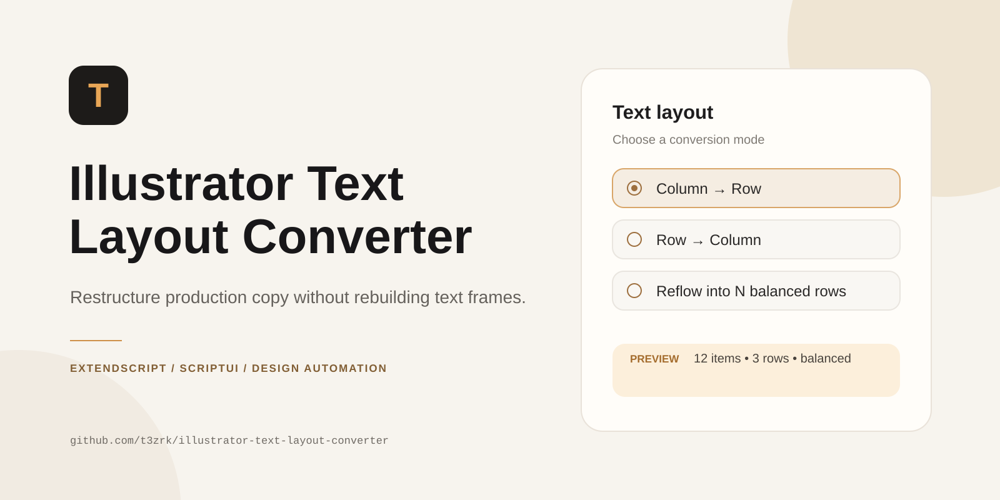

<p align="center">
  
</p>

# Illustrator Text Layout Converter

A designer-focused Adobe Illustrator automation utility for converting list-based copy between **columns, rows, and balanced multi-row layouts** without manually rebuilding text frames.

## Why I built it

Production design work frequently receives copy in the wrong shape for the layout: locations pasted as a vertical list, product labels supplied in a single comma-separated row, or long item lists that need to be redistributed into a fixed number of rows.

The original script solved the basic problem for one selected text frame. This version turns that idea into a safer and more reusable production tool.

## Features

- **Column → Row** conversion
- **Row → Column** conversion
- **Reflow into N balanced rows**
- Processes multiple selected text frames
- Finds text frames nested inside selected groups
- Auto-detects common separators
- Explicit input modes for line breaks, commas, semicolons, and tabs
- Configurable separator for items within a row
- Optional whitespace trimming
- Optional empty-item removal
- Preview before modifying artwork
- Accurate item and changed-frame counts
- Input validation and confirmation before applying changes
- Balanced row distribution instead of a simple ceiling split
- Original v1 preserved in `archive/`

## Example

Input:

```text
Bengaluru
Kochi
Chennai
Pune
Mumbai
Hyderabad
```

**Column → Row**

```text
Bengaluru, Kochi, Chennai, Pune, Mumbai, Hyderabad
```

**Reflow into 2 rows**

```text
Bengaluru, Kochi, Chennai
Pune, Mumbai, Hyderabad
```

## Project structure

```text
illustrator-text-layout-converter/
├─ src/
│  └─ IllustratorTextLayoutConverter.jsx
├─ archive/
│  └─ Column To Row v1.jsx
├─ docs/
│  ├─ hero.svg
│  └─ PORTFOLIO.md
├─ CHANGELOG.md
├─ CONTRIBUTING.md
├─ LICENSE
├─ .gitignore
└─ README.md
```

## Installation

1. Download `src/IllustratorTextLayoutConverter.jsx`.
2. Open Adobe Illustrator.
3. Select one or more text frames, or groups that contain text frames.
4. Go to **File → Scripts → Other Script…**
5. Select the `.jsx` file.
6. Choose the conversion mode and parsing options.
7. Use **Preview** before applying changes.
8. Click **Convert**.

For regular use, copy the JSX file into Illustrator's Scripts folder and restart Illustrator so it appears directly under **File → Scripts**.

## How the reflow algorithm works

The v1 script used `Math.ceil(items / rows)`, which can create visibly uneven layouts—for example `4 / 4 / 2`.

v2 distributes the remainder across the earliest rows so the same 10 items across 3 rows become:

```text
4 / 3 / 3
```

This produces a more balanced result for production layouts.

## Technical notes

The project is written in **Adobe ExtendScript / JavaScript** with **ScriptUI**.

The script intentionally uses ExtendScript-compatible syntax rather than modern browser JavaScript so it remains suitable for Illustrator's scripting environment.

> **Formatting note:** changing a text frame's contents can affect complex mixed character styling. Test on a copy of highly styled text and keep Illustrator Undo available.

## Project evolution

### v1
- One selected text frame
- Three conversion modes
- Fixed comma behavior
- Basic row calculation
- No preview or confirmation

### v2.0.0
- Multi-frame and grouped-text support
- Separator controls
- Balanced row reflow
- Preview workflow
- Validation
- Production-oriented UI
- Better error handling and project documentation

See [`CHANGELOG.md`](CHANGELOG.md) for the full release notes.

## Portfolio positioning

This project demonstrates:

- Adobe Illustrator scripting
- Design-production automation
- Workflow analysis
- ScriptUI product design
- Text parsing and transformation
- Small-tool product thinking
- AI-assisted iterative development

A presentation-ready case-study summary is available in [`docs/PORTFOLIO.md`](docs/PORTFOLIO.md).

## Author

Built by [@t3zrk](https://github.com/t3zrk) as a designer-focused workflow automation project.

## License

MIT License. See [`LICENSE`](LICENSE).
